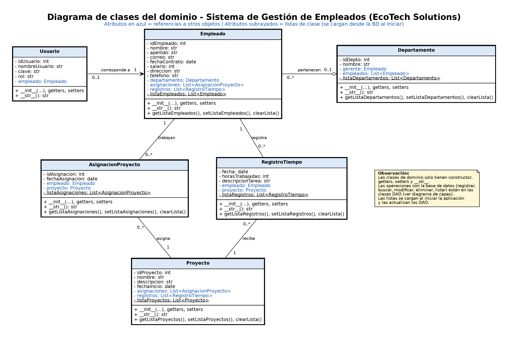

# ECOTECH
## Proyecto de Programación Orientada a Objetos Segura

### 1. Requisitos previos

Para ejecutar el proyecto, es necesario contar con los siguientes elementos:

- Un computador.
- Python instalado.
- La biblioteca PyMySQL, instalada mediante el siguiente comando:
  `pip install PyMySQL requests cryptography`
- XAMPP con el servidor Apache y el servicio de base de datos habilitados.

### 2. Configuración de los datos del usuario

Abra el archivo `mydb_ecotech.txt` y modifique las instrucciones `INSERT` con sus datos personales, según corresponda.

**Primer INSERT: Registro del empleado**

```sql
INSERT INTO EMPLEADO
(NOMBRE, APELLIDO, CORREO, FECHACONTRATO, SALARIO, DIRECCION, TELEFONO, IDDEPARTAMENTO)
VALUES
('Joakin', 'Briones', 'correo@gmail.com', CURDATE(), 99999, 'Recoleta', '123456789', NULL);
```

Reemplace los valores de nombre, apellido, correo electrónico, salario, dirección y teléfono por sus datos correspondientes.

**Segundo INSERT: Creación del usuario**

```sql
INSERT INTO USUARIO
(NOMBREUSUARIO, CLAVE, ROL, IDEMPLEADO)
VALUES
('pepe', SHA2('12345', 256), 'ADMINISTRADOR', LAST_INSERT_ID());
```

Modifique el nombre de usuario y la contraseña según sus preferencias. La función `SHA2` permite almacenar la contraseña mediante su hash SHA-256.

**Importante:** ejecute ambos INSERT en el orden indicado y dentro de la misma conexión para que `LAST_INSERT_ID()` asigne correctamente el identificador del empleado recién creado.

### 3. Configuración de XAMPP y la base de datos

1. Abra el panel de control de XAMPP e inicie los servicios Apache y MySQL (o MariaDB, según la versión instalada).
2. Abra su navegador e ingrese a [http://localhost/](http://localhost/).
3. Acceda a phpMyAdmin para administrar las bases de datos.
4. Consulte el archivo `conex/config.py` para identificar el nombre de la base de datos y los demás parámetros de conexión configurados para el proyecto.
5. Cree la base de datos utilizando el nombre y la configuración correspondientes.

### 4. Ejecución del script SQL

1. Ingrese a la base de datos que acaba de crear desde phpMyAdmin.
2. Seleccione la pestaña **SQL**.
3. Abra el archivo `mydb_ecotech.txt` y copie todo su contenido.
4. Pegue el contenido en el editor SQL de phpMyAdmin.
5. Revise las instrucciones y ejecútelas para crear las estructuras necesarias e insertar los datos iniciales.

### 5. Verificación final

Una vez ejecutado el script, compruebe que las tablas se hayan creado correctamente y que los registros del empleado y del usuario estén presentes en la base de datos.

Con estos pasos, la base de datos quedará preparada para utilizarse con el proyecto ECOTECH.

### 6. Usuarios y roles

El script crea tres usuarios de ejemplo (cambie las claves antes de usar el sistema en serio):

| Usuario | Clave | Rol | Qué puede hacer |
|---|---|---|---|
| `pepe` (editable, ver sección 2) | `12345` | ADMINISTRADOR | CRUD completo y registrar usuarios. **No** accede a las APIs y ve correo, sueldo, dirección y teléfono **encriptados**. |
| `gerente_rrhh` | `Gerente2026` | GERENTE_RRHH | Departamentos, empleados (ve correo, sueldo, dirección y teléfono), asignaciones, horas, proyectos (consulta) y **Servicios Externos (APIs)**. |
| `empleado1` | `Empleado2026` | EMPLEADO | Ver proyectos, sus asignaciones y registrar/ver sus propias horas. |

Si ya había creado la base con una versión anterior del script, ejecute en la pestaña SQL de phpMyAdmin, **una sola vez y en este orden**: `actualizacion_cifrado.txt` (columnas para datos cifrados) y luego `actualizacion_unidad3.txt` (tabla `INDICADOR` y los dos usuarios nuevos; omítalo si ya lo había ejecutado). Después ejecute `python cifrar_datos.py` para cifrar los datos que ya existían.

### 7. Servicios externos (solo rol GERENTE_RRHH)

- **Indicadores económicos** (Dólar, UF, Euro, UTM): `findic.cl` y, si falla, `mindicador.cl`. Se consulta por **fecha** (ENTER = último valor) o por **rango de fechas**, para un indicador o todos. Cada valor se guarda en la tabla `INDICADOR` con el id del usuario que consultó, el autor (fuente), el código, la fecha y el valor.
- **Calcular sueldo en moneda extranjera**: convierte el sueldo de un empleado con el último valor del dólar o euro.
- **Clima y energía solar** (Open-Meteo, sin llave de API): se pide ciudad (y país opcional) y se muestran condiciones actuales (nubosidad, radiación solar, viento) y un pronóstico de 3 días con horas de sol, energía solar (kWh/m²), índice UV, ráfagas y probabilidad de lluvia. Con eso se evalúa el potencial de generación fotovoltaica (ALTO/MEDIO/BAJO) y si las condiciones permiten trabajo en terreno (instalación y mantención de paneles). Los umbrales están al inicio de `servicios/api_clima.py`.

Los detalles técnicos de los errores se guardan en `ecotech_errores.log` (ignorado por git); en pantalla solo se muestran mensajes genéricos.

### 8. Datos sensibles cifrados

Correo, sueldo y dirección de los empleados se guardan **cifrados en la base de datos** (Fernet: AES + HMAC), por lo que tampoco se ven en phpMyAdmin. Solo el **Gerente de RRHH** los ve descifrados; el administrador (y cualquier otro rol) ve `[ENCRIPTADO]`, pero puede crear empleados y modificar esos datos sin verlos (ENTER mantiene el valor actual). El correo único se controla con una huella (`CORREOHASH`).

- Los empleados de ejemplo del script SQL **ya vienen cifrados** en la base (en phpMyAdmin solo se ven textos como `gAAAAAB...`). Para poder leerlos, el proyecto incluye `clave_cifrado.key` (clave de demostración, **se sube al repositorio** para que todo el grupo use la misma). En un uso real genere una clave nueva, no la suba a git y entréguela con la variable de entorno `ECOTECH_CLAVE_CIFRADO`.
- Si tenía datos en texto plano (base anterior), después de ejecutar `actualizacion_cifrado.txt` corra `python cifrar_datos.py`: los deja cifrados al instante. Los empleados que se agreguen o modifiquen desde el programa se guardan siempre cifrados.
- Sin la clave los datos cifrados no se pueden recuperar: respáldela.

### 9. Pruebas

`python -m unittest discover -s tests -t .` (no necesita Internet ni base de datos: las APIs se simulan).

Las decisiones técnicas y el uso de IA están documentados en `docs/JUSTIFICACION_TECNICA.md`.

### 10. Diagrama

